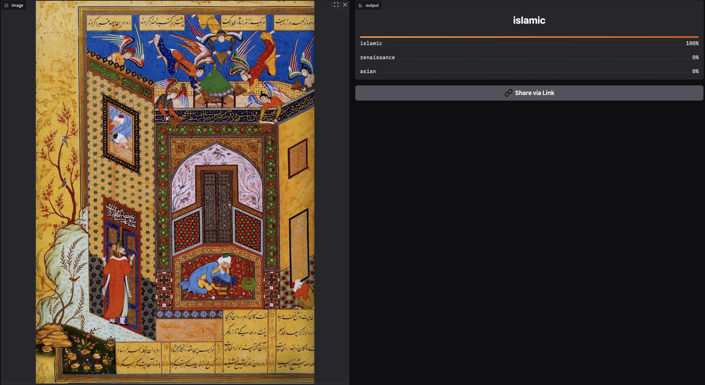
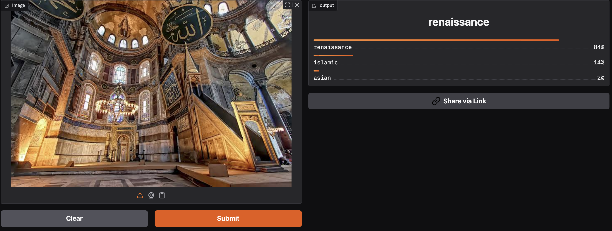
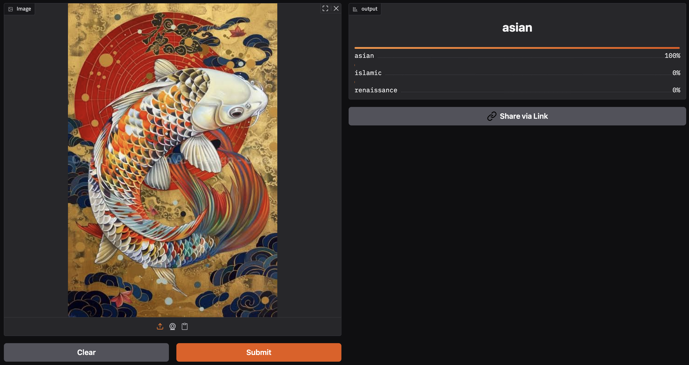
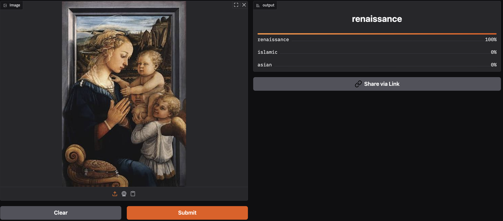

# 🎨 Art Style Classifier

A deep learning model that classifies paintings into **Renaissance**, **Islamic (Middle-Eastern)**, or **Asian** art styles.

**🔗 Live demo:** https://huggingface.co/spaces/Dostonjon-3/art_style_classifier

## How it works

- **Data:** ~90 images per class, collected with DuckDuckGo image search using several queries per class (e.g. Persian/Ottoman miniatures, Chinese ink painting, Japanese ukiyo-e, Korean traditional painting)
- **Model:** ResNet-34 pretrained on ImageNet, fine-tuned with fastai (6 epochs) using data augmentation (`RandomResizedCrop`, `aug_transforms`)
- **App:** Gradio UI deployed on Hugging Face Spaces (ZeroGPU)

## Results

- **~90% accuracy** on the validation set (20% hold-out)
- Renaissance was classified perfectly; most errors were **Islamic ↔ Asian**
- Error analysis showed most mistakes were genuinely hard images (e.g. Persian miniatures, which were historically influenced by Chinese painting), not mislabelled data
- ResNet-34 improved validation loss over ResNet-18 (0.32 vs 0.40), with similar error rate

## Deployment challenges I solved

1. **Bad training data:** one search query returned unrelated images (boats) for the Islamic class. I rewrote and tested the queries before downloading.
2. **Python version mismatch:** the model was trained on Python 3.13 (Colab), but the Space runs Python 3.10, so the exported `model.pkl` couldn't be unpickled (`pathlib._local` missing, then incompatible code objects).
3. **Fix:** switched from pickling the whole fastai `Learner` to saving only the PyTorch `state_dict`, then rebuilding the model and preprocessing in plain PyTorch inside `app.py`. This loads on any Python version.

## Limitations

- Small dataset (~90 images per class)
- It always picks one of the 3 classes, even for art that fits none of them (e.g. Van Gogh)
- "Islamic" and "Asian" are broad categories that each cover several distinct traditions

## Next steps

- Collect more data, especially Islamic miniatures and Korean minhwa
- Multi-label version (e.g. detect several styles in one image)
- Add an "other" class

## Files

- `train_art_classifier.ipynb`: data collection, training, error analysis
- `app.py`: Gradio app (loads the `state_dict`, runs inference)
- `requirements.txt`: dependencies

## Tech

Python · PyTorch · fastai · torchvision · Gradio · Hugging Face Spaces

_Built while following fast.ai's Practical Deep Learning for Coders (Lessons 1–2)._

## Demos

